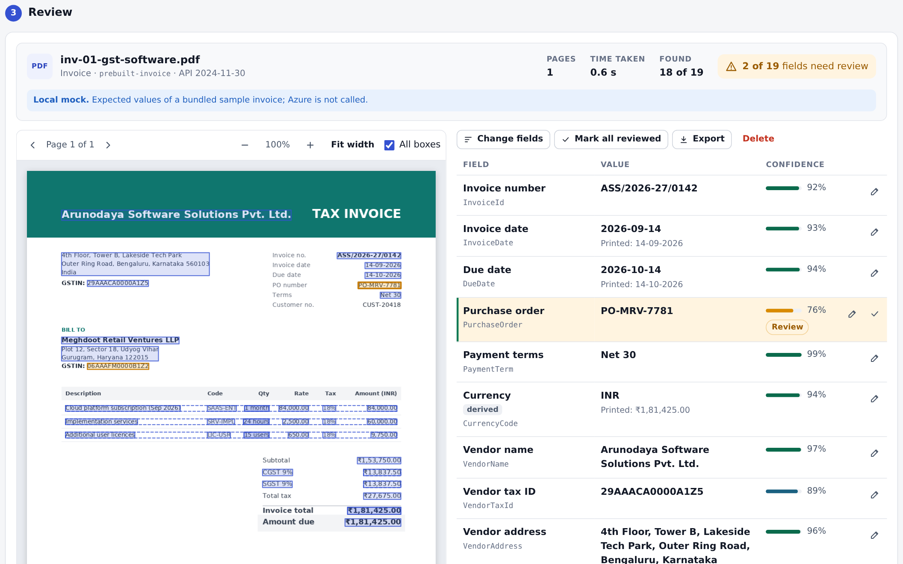
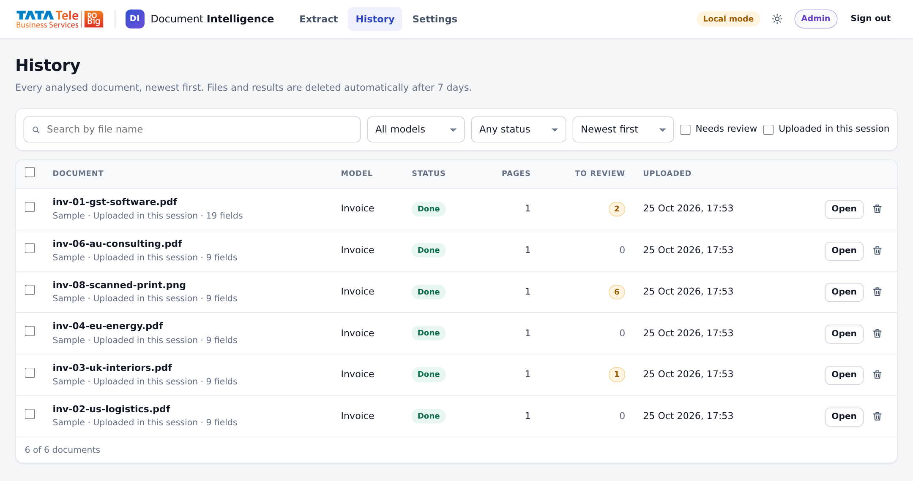

# Document Intelligence

Invoice field extraction on Azure with a confidence score for every field. Every document goes through the same steps:

1. The invoice is uploaded.
2. A pre-built Azure Document Intelligence model analyses it.
3. The fields you chose are extracted with a confidence score for each.
4. You review, correct and export them.

Admins manage field presets and settings, and Users upload, review, correct and export documents, in a secure web app. Each field is shown next to the document with its location highlighted, and low-confidence fields are flagged for review.

The solution is a deployable template. You choose the tier (SKU) of every Azure service in one parameters file and deploy with one command or the **Deploy to Azure** button.

[](https://portal.azure.com/#create/Microsoft.Template/uri/https%3A%2F%2Fraw.githubusercontent.com%2FTTNS-Deployments%2FDocument-Intelligence%2Fmain%2FDeployment%2FARM%2Fazuredeploy.json/createUIDefinitionUri/https%3A%2F%2Fraw.githubusercontent.com%2FTTNS-Deployments%2FDocument-Intelligence%2Fmain%2FDeployment%2FARM%2FcreateUiDefinition.json)

> The button deploys the infrastructure. The application code is deployed by `Deployment/scripts/deploy.sh` or the *Deploy* GitHub workflow (see [Deployment guide](Documents/deployment-guide.md)). The button only works if this repository is public, or if the template URLs point to a location the portal can read.

### Overview

Every Azure resource is defined in a single ARM template, `azuredeploy.json`. SKUs shown are the demo defaults; the dev and prod values are in the [SKU reference](Deployment/README.md).

| # | Name | Description | Service | Template |
|---|------|-------------|---------|----------|
| 1 | Key Vault | Holds the demo password and the Django secret key | Key Vault (standard, RBAC) | azuredeploy.json |
| 2 | Storage | Uploaded files, results, presets and settings, code packages; uploads and results deleted after `retentionDays` | Storage (StorageV2, Standard_LRS, lifecycle policy) | azuredeploy.json |
| 3 | Monitoring | Logs and application telemetry | Log Analytics (30 days, 1 GB/day), Application Insights | azuredeploy.json |
| 4 | Document Intelligence | Pre-built models (invoice, receipt, ID document), API 2024-11-30, managed identity only | Azure AI Document Intelligence (S0, Central India) | azuredeploy.json |
| 5 | Web app | Django UI and API: upload checks, analysis jobs, review with highlights, corrections, exports, History | App Service (Linux, Python 3.12; demo: shared B1 plan) | azuredeploy.json |
| 6 | Identity and access | Web app managed identity with Blob Data Contributor, Cognitive Services User, Key Vault Secrets User | Managed identity, role assignments | azuredeploy.json |
| 7 | Private networking (prod) | Private endpoints and DNS for Blob, Document Intelligence and Key Vault; VNet integration of the web app | VNet, Private Link, Private DNS | azuredeploy.json |

There is no VPN or virtual network gateway, no API Management and no Function app: the web app does all the work. Defender for Cloud (a subscription-level plan) is not deployed by the template.

<br/>

## Architecture


| # | Step | Azure service |
|---|------|---------------|
| 1 | A user uploads PDF, JPEG or PNG files (or tries a sample) in the browser | App Service (Django) |
| 2 | Validation before anything is stored: type, file signature, size, image dimensions, PDF pages; the daily page budget | App Service, Blob Storage (page counter) |
| 3 | Analysis with a pre-built model; the full result is kept | Azure AI Document Intelligence (`begin_analyze_document`, API 2024-11-30) |
| 4 | Normalisation and field selection: dates, amounts with currency, addresses, line items, "Not found", review flags | App Service |
| 5 | Review with highlights, corrections, exports (JSON, CSV, XLSX), History | App Service, Blob Storage |
| 6 | Retention: uploads and results deleted automatically after `retentionDays` | Blob Storage lifecycle management |

Jobs run inside the web app: a queue with two worker threads takes each accepted file, claims it with a conditional write on its result blob (so two processes never run the same job), sends it to Document Intelligence, retries throttling and server errors with back-off, and re-queues unfinished jobs after a restart. The browser follows the status with htmx. All service-to-service access uses the web app's **managed identity**, and the only secrets live in Key Vault.

How to use the web app: [User guide](Documents/user-guide.md) · More detail: [Architecture](Documents/architecture.md) · [Technical specification](Documents/technical-specification.md)

<br/>

## Screens

| Extract and review | History |
|---|---|
|  |  |

- **Extract:** choose the model and preset, tick fields (grouped and searchable), choose whether to include images (off: typed text only, so logos are ignored; on: text in images is read and pictures such as an ID photo are extracted), drop up to 100 files and get one Excel file when all are finished, or try a sample, then review: the document with highlight boxes next to the field table with confidence bars, Review chips, corrections, line items and exports.
- **Batches:** bulk uploads you can leave running and come back to: progress per batch, a review page that steps through the documents (Next needing review), and one Excel file for the whole batch with every correction.
- **History:** every analysed document with status, pages and fields to review; search, filters, bulk export, and delete with confirmation.
- **Settings:** review threshold, daily page limit, maximum pages, retention (shown), and presets to create, edit and delete. No redeploy is needed.

The demo uses one shared password and a role choice at sign-in:

| Role | Access |
|---|---|
| **Admin** | Everything, including presets and settings, and deleting any result |
| **User** | Extract, review, correct and export, see History, delete their own uploads |

<br/>

## Quick start (local mode, no Azure needed)

Local mode replaces every Azure dependency with a local equivalent:

| Azure service | Local replacement |
|---|---|
| Storage | A folder (`.localdata/`) |
| Document Intelligence | A mock with the expected results of eight sample invoices (confidences, boxes) |
| Key Vault and sign-in | A development secret; choose Admin or User without a password |

```bash
make setup     # creates .venv and installs everything (plus Chromium for the UI tests)
make seed      # analyses the eight sample invoices, so History has content
make run       # http://localhost:8000 – choose Admin or User
make test
```

Without `make`:

```bash
python3.12 -m venv .venv && . .venv/bin/activate
pip install -r requirements-dev.txt
python -m docintel seed
cd Code/webapp && python manage.py runserver
```

**Moving to real services:** copy `.env.example` to `.env` and set the variables for one service at a time, for example `ANALYZE_BACKEND=azure` with `DOCINTEL_ENDPOINT` (and `DOCINTEL_KEY`, or your `az login`). Everything else stays local. The `make` targets load `.env`; when you run Python directly, export the variables in your shell instead. See [Local development](Documents/local-development.md) and [Configuration](Documents/configuration.md).

Docker alternative: `make docker-up` runs the web app with the Azurite storage emulator.

<br/>

## Deploy to Azure

1. **Choose SKUs.** Edit [`Deployment/ARM/parameters/demo.parameters.json`](Deployment/ARM/parameters/demo.parameters.json), `dev.parameters.json` or `prod.parameters.json`. Every tier and size is a parameter; see the [SKU reference](Deployment/README.md).
2. **Deploy** infrastructure and code from Azure Cloud Shell. The demo (resource group, region and shared App Service plan come from `Deployment/environments/demo.env`); you choose the password:
```bash
   Deployment/scripts/deploy.sh -e demo --param demoPassword='...'
```
   Other environments: `Deployment/scripts/deploy.sh -e dev -g rg-docint-dev --param demoPassword='...'` (or `-e prod`).
3. Open the web app URL printed at the end and sign in with the shared password, choosing Admin or User.
4. Upload an invoice, or press **Try a sample** on the Extract page.
5. Optional: change tiers or the Document Intelligence region (`docIntelLocation`) and run the same command again; for production, use `prod.parameters.json` with private networking and deploy the code from inside the network.

Full steps, provider and availability checks, CI/CD with GitHub Actions and troubleshooting are in the [Deployment guide](Documents/deployment-guide.md).

<br/>

## Repository layout

| Path | Contents |
|---|---|
| [`Code/core`](Code/core) | `docintel` Python package: catalog and presets, storage, upload checks and page budget, Document Intelligence client (Azure and mock), jobs, normalisation, exports, CLI |
| [`Code/webapp`](Code/webapp) | Django web app: sign-in, Extract, review, History, Settings, JSON API; vendored htmx and pdf.js |
| [`Config`](Config) | Field catalog per model, presets, default settings (YAML) |
| [`Data/sample_invoices`](Data/sample_invoices) | Eight invented sample invoices (PDF and PNG) with expected fields and boxes |
| [`Deployment/ARM`](Deployment/ARM) | ARM template, per-environment SKU parameter files, portal form for the Deploy button |
| [`Deployment/scripts`](Deployment/scripts) | `deploy.sh`, `deploy_code_arm.sh`, `package.sh` |
| [`Deployment/environments`](Deployment/environments) | Deployment variables for the demo environment |
| [`Documents`](Documents) | Architecture, technical specification, deployment guide, configuration, local development, user guide |
| [`qa`](qa) | UI and deployment-script tests, test cases, test report, screenshot script |
| [`imgs`](imgs) | Architecture diagram and screenshots |
| [`.github/workflows`](.github/workflows) | CI (tests, template validation, package) and Deploy (manual, per environment) |

<br/>

## Status and roadmap

| Phase | Scope | Status |
|---|---|---|
| 1 | Upload (single or named batches processed in the background, reviewed together, one Excel file), pre-built model analysis, typed-text-only or with-images mode with picture extraction, field selection and presets, review with highlights, correction, exports, History with retention, demo sign-in | Implemented and verified locally (core, web, UI and deployment-script tests; package run under gunicorn). The demo environment was deployed with `deploy.sh` (infrastructure and code); checks against the live service are in progress. Untested: private networking (prod), the dev and prod parameter files |
| 2 | Entra ID sign-in with real roles, custom models for company-specific documents, more pre-built models, an API for system integration | Planned |

Supported files are PDF, JPEG and PNG, up to 10 MB and 10 pages per file by default (both configurable), with a daily page budget. The interface is in English. Invoices in other languages and scripts work as far as the pre-built model supports them.

<br/>

## Support

See [SUPPORT.md](SUPPORT.md). Security issues: [SECURITY.md](SECURITY.md).
