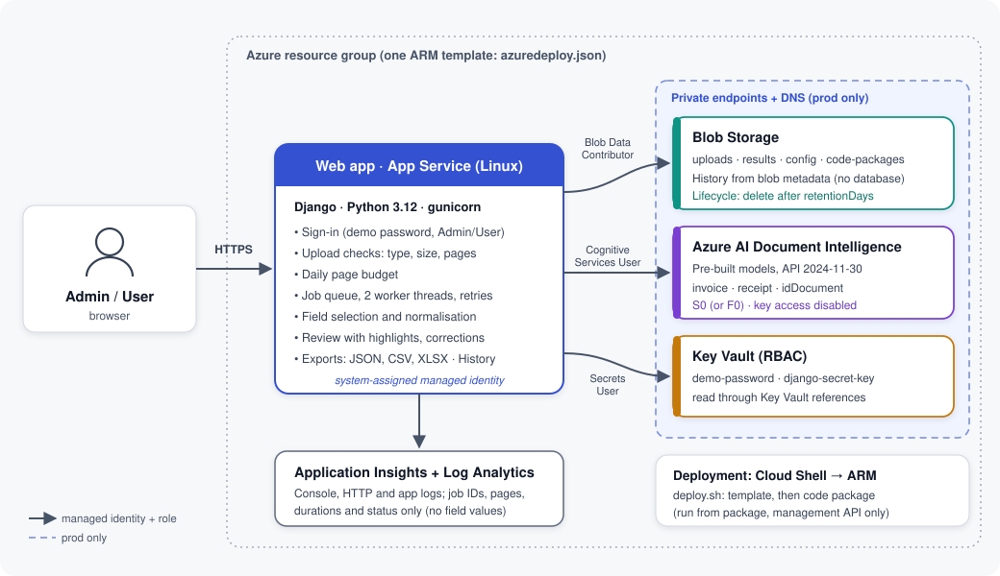

# Document Intelligence on Azure

ARM templates, shell scripts, Function code and an upload page for a document extraction solution built on Azure Document Intelligence. You open a web page, upload an invoice, receipt, ID or any other document, choose a prebuilt or custom model, and get back the extracted fields, each with a confidence score. Low-confidence fields are flagged for review.

Every SKU, tier and limit is set in one file, [`config/skus.env`](config/skus.env), so you can resize the deployment without touching the templates. Deployment is idempotent and runs with one command.

A simple project page that summarizes the deployment is in [`index.html`](index.html) and can be published with GitHub Pages. The page that users upload documents through is a different file, [`web/index.html`](web/index.html), and `deploy.sh` publishes it to your storage account.

## Overview

Resources are listed in deployment order, and template numbers match that order.

| # | Name | Description | Service | SKU inputs (`config/skus.env`) | Template |
| - | ---- | ----------- | ------- | ------------------------------ | -------- |
| 1 | Network | VNet that holds the VPN gateway | Virtual Network | none (ranges are set in `scripts/common.sh`) | [`01-network.json`](templates/01-network.json) |
| 2 | VPN Gateway | Connection point to another network | VPN Gateway | `VPN_GATEWAY_SKU`, `VPN_GATEWAY_GENERATION` | [`02-vpn-gateway.json`](templates/02-vpn-gateway.json) |
| 3 | Storage | Uploaded documents, results, and the upload page | Storage Account (blob, static website) | `STORAGE_SKU`, `STORAGE_ACCESS_TIER` | [`03-storage.json`](templates/03-storage.json) |
| 4 | Document Intelligence | Extracts fields with prebuilt and custom models | Document Intelligence (Foundry Tools) | `DOCINT_SKU` | [`04-docintelligence.json`](templates/04-docintelligence.json) |
| 5 | Function app | Receives uploads and calls Document Intelligence | Azure Functions (Consumption) | `FUNCTION_PLAN_SKU`, `FUNCTION_RUNTIME` | [`05-functionapp.json`](templates/05-functionapp.json) |
| 6 | Access roles | Function identity to Storage and Document Intelligence | Azure RBAC | none | [`06-rbac.json`](templates/06-rbac.json) |
| 7 | API gateway | Public front door with key, CORS and rate limit | API Management (Consumption) | `APIM_SKU`, `APIM_CAPACITY`, `APIM_RATE_LIMIT_CALLS_PER_MIN` | [`07-apim.json`](templates/07-apim.json) |
| 8 | VPN connection (optional) | VNet-to-VNet link to another gateway | VPN Gateway connection | none | [`08-vpn-connection.json`](templates/08-vpn-connection.json) |

## Deployed Resources in More Detail

- **Network** (`templates/01-network.json`): A VNet with a `GatewaySubnet`. Nothing else deploys into it today.
- **VPN Gateway** (`templates/02-vpn-gateway.json`): A route-based gateway with a zone-redundant Standard public IP. It is created in the background while the rest deploys, because it takes 30 to 45 minutes.
- **Storage Account** (`templates/03-storage.json`): StorageV2 with private `incoming` and `results` containers, soft delete, TLS 1.2 minimum, and the static website that serves the upload page. It also holds the Function app's runtime files.
- **Document Intelligence** (`templates/04-docintelligence.json`): One account that serves both prebuilt models and your custom models, with a custom subdomain so the Function can sign in with its managed identity.
- **Function app** (`templates/05-functionapp.json`): A Linux Consumption app with a system-assigned identity. The code in [`functions/`](functions/) exposes `analyze`, `results/{id}`, `models` and `health`.
- **Access roles** (`templates/06-rbac.json`): Storage Blob Data Contributor on the storage account and Cognitive Services User on Document Intelligence, so the Function needs no keys for either.
- **API Management** (`templates/07-apim.json`): A Consumption-tier gateway that requires a subscription key, adds the Function's key itself (so the Function cannot be called directly without it), allows browser calls only from the upload page's origin, and rate-limits each key. A `web-upload` subscription is created for the upload page.
- **VPN connection** (`templates/08-vpn-connection.json`): Optional. Created by `connect-vpn.sh` when you have another gateway to connect to.

### How it fits together

The browser loads the upload page from the storage static website. When you choose a file, the page sends it to API Management with your subscription key. API Management forwards it to the Function app, which stores the original in the `incoming` container, calls Document Intelligence with the chosen model, saves the extracted fields to the `results` container, and returns them. The page shows each field with its confidence and lets you download the result as JSON or CSV.



## SKU Inputs

All sizing lives in [`config/skus.env`](config/skus.env).

| Variable | Controls | Default |
| -------- | -------- | ------- |
| `DOCINT_SKU` | Document Intelligence tier | `S0` |
| `VPN_GATEWAY_SKU`, `VPN_GATEWAY_GENERATION` | VPN gateway size and generation | `VpnGw1AZ`, `Generation1` |
| `FUNCTION_PLAN_SKU`, `FUNCTION_RUNTIME` | Functions plan and Linux runtime | `Y1`, `Python\|3.11` |
| `APIM_SKU`, `APIM_CAPACITY` | API Management tier | `Consumption`, `0` |
| `STORAGE_SKU`, `STORAGE_ACCESS_TIER` | Storage redundancy and access tier | `Standard_LRS`, `Hot` |
| `MAX_UPLOAD_MB` | Largest file the page and API accept | `20` |
| `APIM_RATE_LIMIT_CALLS_PER_MIN` | Calls per minute for each key | `30` |
| `DEFAULT_MODEL`, `AVAILABLE_MODELS` | Models offered in the upload page | `prebuilt-invoice`, five prebuilt models |
| `REVIEW_THRESHOLD` | Confidence below which a field is flagged | `0.8` |

Notes on the defaults:

- **VPN gateway SKU.** Azure no longer lets you create new gateways on the non-AZ `VpnGw1` to `VpnGw5` SKUs, so the `VpnGw1` tier in the original estimate is deployed as `VpnGw1AZ`. `deploy.sh` refuses the old names. Check the AZ price on the pricing calculator.
- **Functions plan.** The Linux Consumption plan is retiring on 30 September 2028. It works today and matches the Consumption tier in the estimate, but plan a move to Flex Consumption before then.
- **Consumption tier estimate inputs** such as 256 MB memory, 30 second execution time and 2,000 executions are billing assumptions for the cost estimate, not settings. The Function's timeout is set in `functions/host.json`.
- **Using another file.** Run `SKU_FILE=/path/to/other.env ./deploy.sh` to keep separate sizing for test and production.

## Repository Layout

```
Document_Intelligence/
├── README.md
├── index.html                  # project page (GitHub Pages)
├── deploy.sh                   # deploys everything, in order
├── connect-vpn.sh              # optional: VNet-to-VNet connection
├── config/
│   └── skus.env                # every SKU, tier and limit input
├── scripts/
│   └── common.sh               # shared settings and helpers
├── templates/                  # resource-group-scope ARM templates, in deployment order
│   ├── 01-network.json
│   ├── 02-vpn-gateway.json
│   ├── 03-storage.json
│   ├── 04-docintelligence.json
│   ├── 05-functionapp.json
│   ├── 06-rbac.json
│   ├── 07-apim.json
│   └── 08-vpn-connection.json
├── functions/                  # Python Function app (upload API)
│   ├── function_app.py
│   ├── host.json
│   └── requirements.txt
├── web/                        # upload page, published to the storage static website
│   ├── index.html
│   └── config.js
├── imgs/                       # banner and architecture diagram
├── LICENSE
├── CODE_OF_CONDUCT.md
├── SECURITY.md
├── SUPPORT.md
└── .gitignore
```

## Prerequisites

1. **An Azure subscription** where you can create resources and role assignments: Owner, or Contributor plus User Access Administrator, on the subscription or resource group. Step 6 creates role assignments, which Contributor alone cannot do.
2. **Azure CLI.** Check with `az --version`. Install: <https://learn.microsoft.com/en-us/cli/azure/install-azure-cli>
3. **jq**, used to parse deployment outputs. Check with `jq --version`. Install with `sudo apt install jq` (Debian/Ubuntu), `brew install jq` (macOS), or see <https://jqlang.org/download/>
4. **Bash.** The scripts use `set -euo pipefail`. On Windows, run them through WSL or Git Bash rather than PowerShell or cmd.
5. **zip, Python, or PowerShell**, so the script can package the Function code. Any one is enough.
6. **An email address** for API Management's publisher contact.

## Step-by-Step: Deploying from Scratch

1. **Clone the repository**

   ```bash
   git clone https://github.com/TTNS-Deployments/Document_Intelligence.git
   cd Document_Intelligence
   ```

2. **Log in to Azure**

   ```bash
   az login
   az account set --subscription "<subscription-id-or-name>"
   ```

3. **Set your SKUs and settings.** Open `config/skus.env` and adjust the values. Then review the settings at the top of `scripts/common.sh`. Each can also be set with an environment variable:

   ```bash
   RESOURCE_GROUP="rg-docint-dev"
   LOCATION="centralindia"
   NAME_PREFIX="docint"
   ENVIRONMENT="dev"
   APIM_PUBLISHER_EMAIL="you@yourcompany.com"
   ```

   Resource names are generated from `NAME_PREFIX`, `ENVIRONMENT`, and a uniqueness suffix, so re-running with the same values updates existing resources instead of colliding with them.

4. **Run the script**

   ```bash
   chmod +x deploy.sh
   ./deploy.sh
   ```

5. **Review the plan and confirm.** The script prints every SKU it is about to deploy and asks for confirmation. Use `./deploy.sh --yes` to skip the prompt in automation.

6. **Read the summary at the end.** It lists the upload page URL, the API key for the page, and every resource name.

A full run takes 35 to 60 minutes, almost all of it waiting for the VPN gateway. Everything else finishes in about 10 to 15 minutes, and the script starts the gateway first so the two overlap.

## Using the Upload Page

1. Open the **Upload page** URL from the deployment summary.
2. Paste the **API key** from the summary. It is kept only for that browser tab.
3. Choose a model. Prebuilt models are listed; choose "Custom model ID..." to use your own.
4. Drop in a file (PDF, JPG, PNG, TIFF, BMP, HEIF, DOCX, XLSX or PPTX, up to the limit in `skus.env`) and select **Extract fields**.
5. Review the table. Fields below `REVIEW_THRESHOLD` are marked **Review**. Download the result as JSON or CSV.

Uploaded files and results are stored in the `incoming` and `results` containers of the storage account, so you can compare what the model returned with the original document, which helps when you are tuning accuracy.

### Adding your custom models to the page

Train your model in Document Intelligence Studio on the account this repository creates, then add its model ID to `AVAILABLE_MODELS` in `config/skus.env` and re-run `./deploy.sh`. You can also just choose "Custom model ID..." in the page without changing anything.

## The API

The upload page is one client of this API, so scripts and other applications can use it too. Send the API key in the `Ocp-Apim-Subscription-Key` header.

| Method and path | What it does |
| --------------- | ------------ |
| `POST /analyze?model=<id>&filename=<name>` | Body is the raw file. Returns the extracted fields, page count and a `documentId`. |
| `GET /results/{documentId}` | Returns a stored result. |
| `GET /models` | Returns the default model and the models offered in the page. |
| `GET /health` | Returns `{"status":"ok"}`. |

```bash
curl -X POST "$API_BASE_URL/analyze?model=prebuilt-invoice&filename=invoice.pdf" \
  -H "Ocp-Apim-Subscription-Key: $API_KEY" -H "Content-Type: application/pdf" \
  --data-binary @invoice.pdf
```

## After Deployment

- **Share the API key carefully.** Anyone with it can upload documents and use up Document Intelligence pages. To read it again:

  ```bash
  az rest --method post --url "https://management.azure.com/subscriptions/<subscription-id>/resourceGroups/rg-docint-dev/providers/Microsoft.ApiManagement/service/<apim-name>/subscriptions/web-upload/listSecrets?api-version=2022-08-01" --query primaryKey -o tsv
  ```

  To rotate it, call the same URL with `regeneratePrimaryKey` in place of `listSecrets`, then give people the new key.
- **For real users, add sign-in.** A shared key is fine for a proof of concept. Before wider use, validate Microsoft Entra ID tokens in API Management (the `validate-jwt` policy) and give each user or application its own subscription.
- **Connect the VPN gateway** if you need it. See the next section.

## Connecting the VPN Gateway

The gateway is created with no connections. To link it to another VNet's gateway:

```bash
REMOTE_GATEWAY_ID="/subscriptions/<id>/resourceGroups/<rg>/providers/Microsoft.Network/virtualNetworkGateways/<name>" ./connect-vpn.sh
```

The script asks for a shared key, creates this side of the connection, and prints the command to create the matching connection on the other side with the same key. The two address ranges must not overlap; this stack uses `10.30.0.0/24` by default.

## Redeploying a Single Piece

Every deployment is named after its template. Re-running `./deploy.sh` updates what changed and leaves the rest as it is, which is the simplest way to change a SKU or a limit. To publish only a change to the upload page or Function code, edit the file and run `./deploy.sh` again; both are re-published on every run.

## Tearing Everything Down

```bash
az group delete --name rg-docint-dev --yes --no-wait
```

Document Intelligence accounts and Consumption-tier API Management services are soft-deleted, so re-creating them in the same region fails until they are purged:

```bash
az cognitiveservices account purge --name <docint-account-name> --resource-group rg-docint-dev --location centralindia
az apim deletedservice purge --service-name <apim-name> --location centralindia
```

## Assumptions

- Resource group `rg-docint-dev` in `centralindia`, prefix `docint`, environment `dev`. All are overridable.
- The services are the ones in the cost estimate: Document Intelligence (prebuilt and custom, one S0 account), VPN Gateway, Functions on Consumption, API Management on Consumption, and one Storage Account. Nothing else is deployed. There is no Key Vault, Application Insights or Log Analytics, so Function logs are limited to what the platform keeps by default. Add them if you need them.
- All endpoints are public, because the Consumption tiers cannot join a VNet. See "What the VPN Gateway does here".
- The Function host keeps one Storage account key in an app setting, which the Consumption plan requires for its runtime files. Document Intelligence and Blob access use the managed identity.
- The templates were compiled with the Bicep CLI, the Function code was tested against the Document Intelligence SDK's data shapes with fake clients, the upload page was tested in a headless browser against a mock API, and the scripts were exercised against a mock Azure CLI. None of it has been run against a live subscription, so do the first deployment in a non-production subscription.

## Cost Note

The VPN gateway bills every hour regardless of use and is usually the largest fixed cost here. API Management on Consumption and Functions bill per call, Document Intelligence bills per page, and Storage is small at this scale. Change the SKUs in `config/skus.env`, then review current pricing before deploying: <https://azure.microsoft.com/en-us/pricing/calculator/>

## Troubleshooting

- **`az: command not found` or `jq: command not found`**: install the missing tool. See Prerequisites.
- **`Run 'az login' first.`**: you are not authenticated. Run `az login` and retry.
- **`Set APIM_PUBLISHER_EMAIL`**: API Management requires a publisher email. Set the variable, or run without `--yes` to be asked.
- **`VPN_GATEWAY_SKU=VpnGw1 can no longer be created`**: use the AZ variant, for example `VpnGw1AZ`.
- **A Linux Consumption error when creating the Function app**: the plan is on a retirement path and may be restricted in some regions or subscriptions. Try another region, or move the Function app to Flex Consumption.
- **`AuthorizationFailed` on role assignments (step 6)**: you need User Access Administrator or Owner.
- **No Function host key after 6 minutes**: the code deployment may have failed to build. Open the Function app in the portal, check the deployment logs, then re-run `./deploy.sh`.
- **The page says the API could not be reached, or the browser console shows a CORS error**: the API Management CORS policy only allows the upload page's own address. Open the page from the exact URL printed in the summary, and re-run `./deploy.sh` if the storage account was recreated.
- **The page says the API key was not accepted**: paste the key from the summary, with no spaces. See "After Deployment" to read or rotate it.
- **A file is rejected as too large**: raise `MAX_UPLOAD_MB` in `config/skus.env` and re-run `./deploy.sh`.
- **Document Intelligence returns an error for a file**: the model may not support that file type, or the custom model ID is wrong. The page shows the service's message.
- **The VPN gateway step is slow or fails**: it takes 30 to 45 minutes. If it failed, see `az deployment group show -g rg-docint-dev -n 02-vpn-gateway`; the rest of the stack is already deployed and usable.

## Contributing and Support

See [SUPPORT.md](SUPPORT.md) for questions and bug reports, [SECURITY.md](SECURITY.md) for reporting vulnerabilities, and [CODE_OF_CONDUCT.md](CODE_OF_CONDUCT.md) for community expectations.

## License

Released under the [MIT License](LICENSE).
